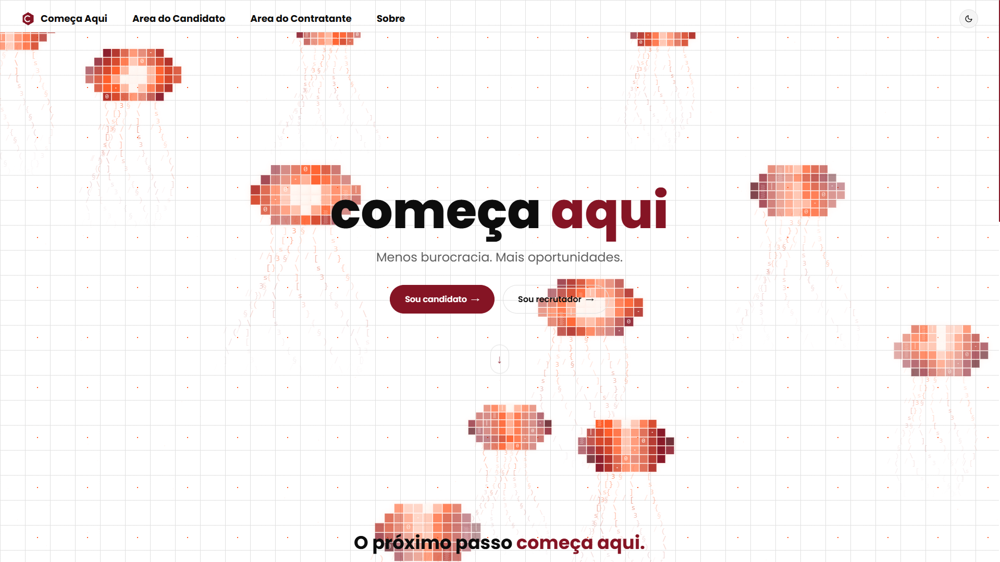

# start-here (Começa Aqui)



Plataforma web de vagas de emprego, em forma de protótipo front-end com Supabase como backend. Há duas áreas: a do **candidato**, para ver e salvar vagas, e a do **contratante**, para cadastrar a empresa, publicar, pausar, editar o status e excluir vagas. Os dados ficam em um banco Postgres no Supabase, com políticas de segurança por linha (RLS) para que cada empresa acesse apenas as próprias vagas.

## Funcionalidades

- Página inicial com apresentação e atalhos para as áreas do candidato e do contratante (`View/index.html`).
- **Área do candidato** (`View/vagas.html`): lista as vagas com status "Ativa" e mostra os detalhes de cada uma (descrição, dados da vaga, habilidades requeridas e contato).
- Salvar vagas de interesse no navegador, guardadas no `localStorage` (`Model/model.js`).
- **Cadastro e login do contratante** (`View/contratante-login.html`) com e-mail e senha pelo Supabase Auth. O cadastro pede nome da empresa, CNPJ ou CPF (com máscara e validação do dígito verificador) e confirmação de senha.
- **Painel do contratante** (`View/contratante.html`): lista as vagas da empresa, com busca por cargo, filtro por status, ação de pausar ou ativar, exclusão com confirmação e botão de sair.
- **Publicação de vaga** (`View/contratante-nova-vaga.html`): cargo, cidade, modalidade (Presencial, Híbrido ou Remoto), nível, tipo de contratação (CLT, PJ ou Estágio), salário, descrição, benefícios, habilidades, contato e link externo.
- Seleção de habilidades por categoria, com busca, a partir de `Model/habilidades.json`.
- Suporte a tema escuro, com a preferência lida do `localStorage`.

## Tecnologias

- HTML5, CSS3 e JavaScript puro (sem framework)
- Supabase: Auth (cadastro e login), Postgres (tabelas `empresas` e `vagas`), funções e triggers em PL/pgSQL e RLS
- Google Fonts (Poppins)

## Estrutura

```
start-here/
├── index.html                       redireciona para View/index.html
├── View/
│   ├── index.html                   página inicial
│   ├── vagas.html                   área do candidato
│   ├── contratante-login.html       login e cadastro do contratante
│   ├── contratante.html             painel do contratante
│   ├── contratante-nova-vaga.html   publicar vaga
│   ├── style.css                    estilos
│   └── assets/                      imagens de pré-visualização
├── Controller/
│   └── controller.js                lógica das telas
├── Model/
│   ├── model.js                     vagas salvas e validação de CPF/CNPJ
│   ├── habilidades.json             habilidades por categoria
│   └── supabase-config.js           URL e chave do Supabase
├── supabase-schema.sql              tabelas, trigger e políticas RLS
└── supabase-schema-view-publica.sql view pública com o nome das empresas
```

## Como executar

1. Crie um projeto no Supabase.
2. No painel do projeto, abra **SQL Editor**, cole o conteúdo de `supabase-schema.sql` e execute. Depois execute também `supabase-schema-view-publica.sql`.
3. Em **Project Settings > API**, copie a URL e a chave `anon public` para `Model/supabase-config.js`. O próprio arquivo traz essa orientação.
4. Sirva a pasta por um servidor local. Abrir os arquivos direto do disco não funciona, porque o `fetch` de `habilidades.json` exige HTTP. Como sugestão (não consta no código), na raiz do projeto rode `python -m http.server 8000` e acesse `http://localhost:8000`.

A raiz redireciona para `View/index.html` após 1,5 segundo.

## Observações

- O projeto é um protótipo. A segurança depende das políticas RLS criadas em `supabase-schema.sql`, e não do front-end.
- A chave `anon` fica no front-end, o que é esperado pelo Supabase. Ainda assim, `Model/supabase-config.js` está versionado com valores preenchidos. Recomenda-se revisar isso antes de publicar e usar um projeto próprio.
- Não há tabela de candidatos nem de candidaturas. A forma de se candidatar parece ser pelo contato ou pelo link externo da vaga (a confirmar).
- A lista de vagas salvas do candidato fica só no navegador e não é sincronizada entre dispositivos.
- O cadastro de empresa aceita CPF ou CNPJ. Se o Supabase estiver com confirmação de e-mail ativa, a conta só entra após a confirmação.
- Não há build, gerenciador de pacotes nem testes automatizados.

## Autor

Desenvolvido por [Juliano Sobrinho](https://github.com/JuhhSobrinho).
